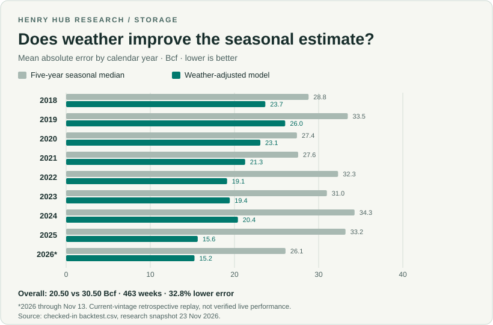

# Henry Hub Storage Forecaster

**John Barreto · Independent natural gas research**

How much can a week of observed weather tell us about the next U.S. Energy Information Administration (EIA) storage report? This study estimates the change in Lower 48 working-gas inventories between consecutive Fridays. A positive change means stocks rose, a negative change means they fell, and Bcf means billion cubic feet.

[Explore the archived dashboard](https://neurax-jb.github.io/henry-hub-storage-forecaster/lab/storage/) · [Read the research note](lab/research/storage-weather.md) · [Download the weekly comparisons](lab/storage/backtest.csv)

## What weather added

In the 23 November 2026 snapshot, a weather-adjusted estimate cut the average absolute miss by **10.00 Bcf (32.8%)**. Both methods were scored on the same 463 weeks, from 5 January 2018 through 13 November 2026.

| Method | Average absolute miss | Weeks with the closer estimate |
| --- | ---: | ---: |
| Five-year seasonal median | 30.50 Bcf | 197 |
| Seasonal median plus observed weather | 20.50 Bcf | 266 |

The weather model came closer in 57.5% of weeks. Some of its gains were large. For the week ending 30 January 2026, stocks fell by 359 Bcf. Seasonality alone implied a 174 Bcf decline. The weather model estimated a 336 Bcf decline. The research note also examines the April 2020 week when adding weather turned a near-correct estimate into a miss of 83 Bcf. [Compare both weeks](lab/research/storage-weather.md#two-weeks-where-weather-changed-the-answer)

## How the estimate works

The benchmark takes the median storage change on the nearest Friday to the same calendar date in each of the previous five years. The model starts with that estimate and adjusts for how much warmer or colder the week was than usual. It uses NOAA’s population-weighted, Lower 48 heating and cooling degree days from Friday through Thursday. A rolling regression learns the adjustments from 104 to 156 earlier eligible weeks. The target is the change in reported stocks, which can include reclassifications. [Model equations and eligibility rules](lab/storage/model.py) · [Input definitions and sources](lab/data/README.md)

The replay uses historical observations as available when the snapshot was built. Their original publication times are unverified for some weeks, and upstream revisions can change historical values. As of 23 November 2026, the forecast ledger held one estimate and zero completed prospective scores. Its entry records when the estimate was issued, its training period and the input hashes. [Inspect the 20 November ledger entry](lab/storage/ledger/2026-11-20.json) · [Check the maintained forecast publication](https://neurax-jb.github.io/Henry-Hub-Futures-Curve-Explorer-How-the-Natural-Gas-Market-prices-winter/lab/storage/)

## Reproduce the comparison

- **Read the numbers.** [Recalculate the headline metrics](lab/README.md#recalculate-the-scorecard) with Python’s standard library and the checked-in CSV.
- **Open the dashboard locally.** From the repository root, run `python -m http.server 8000` and open `http://localhost:8000/lab/storage/`. A regular Python installation on Windows, macOS or Linux can serve the archived dashboard.
- **Run the checks.** The [validation guide](VALIDATION.md) lists the pinned dependencies, Python and Node.js versions, model tests, dashboard tests and data-integrity checks. Use Linux, macOS or WSL to rebuild the refresh pipeline.

The [source snapshot](SOURCE_SNAPSHOT.json) records the upstream revision and frozen file hashes. The [maintained research repository](https://github.com/NeuraX-JB/Henry-Hub-Futures-Curve-Explorer-How-the-Natural-Gas-Market-prices-winter) runs the forecast publication and scoring pipeline. For licensing, original data credits and reuse, see [data use and attribution](DATA_SOURCES.md). This study is provided for research and education.
